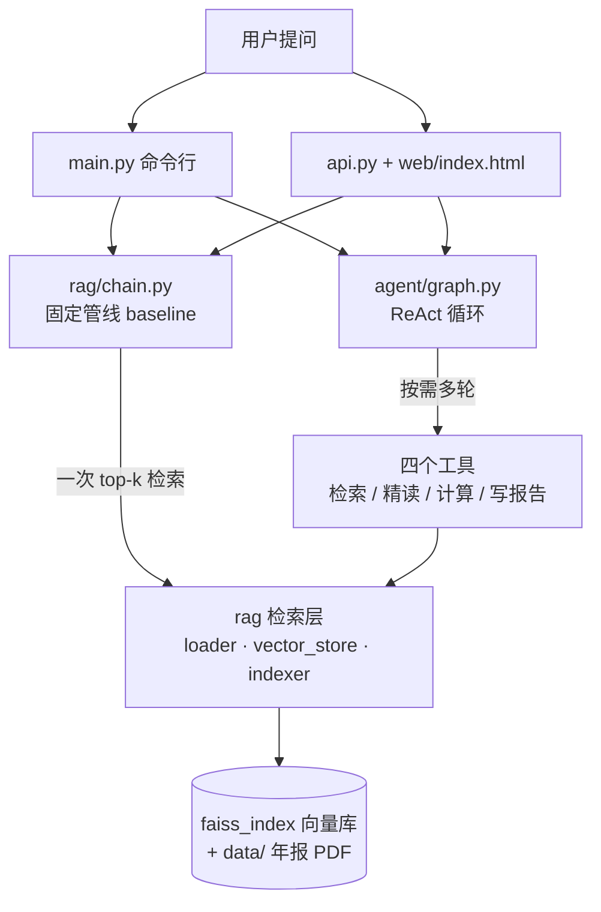
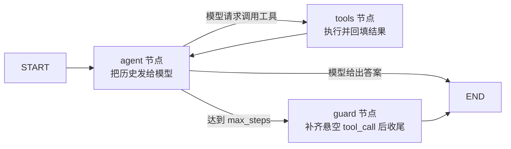

# 年报核对 Agent

> **问它财报里的一个数字，它回答完会告诉你这个数字在哪一页。**
> 年报里没披露的，它说「未披露」——而不是编一个看起来合理的数。

语料是两份真实年报（苏宁环球 185 页 + 腾讯控股 282 页，共 467 页）。
每一轮，模型可以自己决定：要不要再查一次、要不要翻回原页核对、要不要调计算器。

| **30 / 30** | **24 → 30** | **7.8×** |
|:---:|:---:|:---:|
| 30 道确定性评测通过 | 固定管线 → Agent | 输入 token 的代价 |

---

## 为什么不是「又一个 chat with PDF」

| | 普通 RAG 问答 | 这个项目 |
|---|---|---|
| 输出 | 一段自然语言答案 | 答案 + 每个数字的 *(文件, 页码)* |
| 数字来源 | 模型复述召回片段，可能拼错精度 | 必须 `read_document` 回原页核对 |
| 同一指标两个口径 | 不知道有这回事 | 主动列出两个口径及各自出处 |
| 文档没披露 | 容易编一个「合理」的数 | 明确说「年报标注不适用」 |
| 验收方式 | 人读着像不像 | 要点关键词 + *(文件, 页码)* 确定性判分 |

一个真实的例子：问「腾讯控股 2025 年所得税开支是多少？」

- 管理层讨论（p.11）写 **475 亿**，报表附注（p.204/205）写 **47,448 百万**。
- 通用 RAG 只会挑先召回的那一个，用户无从察觉这里存在口径问题。
- 这个项目会把两个都摆出来，并说明是**同一金额的两种列示精度**。

> 这一条是「核对」区别于「问答」的地方，也是别人 demo 不出来的。

---

## 架构

两条路径共用同一套检索底座，可以当场对照效果与成本：



Agent 这一侧的循环，三个节点足够：



四个工具的分工：

| 工具 | 类型 | 作用 |
|---|---|---|
| `search_knowledge_base` | 只读 | 语义检索，返回带文件名/页码的片段（**粗筛**） |
| `read_document` | 只读 | 读指定 PDF 的指定页原文（**精读**，核对上下文与数字口径） |
| `calculate` | 纯函数 | AST 白名单四则运算，不使用 `eval` |
| `write_report` | 有副作用 | 把结论写成 `reports/*.md` |

---

## 快速开始

```powershell
git clone https://github.com/wlfly929/annual-report-auditor.git
cd annual-report-auditor

python -m venv .venv
.venv\Scripts\activate
pip install -r requirements.txt

# 复制 .env.example 为 .env，填两个 Key（见下表）
python main.py "苏宁环球2025年营业收入是多少？同比变化如何？"
```

首次运行会自动把 `data/` 里的 PDF 建成向量库（调用 Embedding API，按语料大小通常 1–3 分钟）；
之后每次启动只做增量校验，**没有变更就一次 API 都不调**。

| 环境变量 | 必填 | 说明 |
|---|---|---|
| `DEEPSEEK_API_KEY` | ✅ | 对话模型（DeepSeek） |
| `OPENAI_API_KEY` | ✅ | Embedding 向量模型（走 OpenAI 兼容接口；DeepSeek 不提供向量模型） |
| `OPENAI_BASE_URL` | ⬜ | 换第三方兼容端点时填，如阿里云百炼 |
| `EMBEDDING_MODEL` | ⬜ | 默认 `text-embedding-3-small` |
| `DEEPSEEK_MODEL` | ⬜ | 默认 `deepseek-chat` |

网页版（SSE 流式，能看到每一步工具调用）：

```powershell
uvicorn api:app --reload --port 8000
# 打开 http://127.0.0.1:8000
```

---

## 评测：同一套题，跑两遍

`evaluation/` 是一套 **30 题确定性评测**，不请 LLM 当裁判。
判分 = 要点关键词覆盖 ≥ 60% **且** *(文件, 页码)* 命中；拒答题命中否定表述即通过。

```powershell
python evaluation/check_questions.py   # 先校验题库：要点和页码是否真对得上原文
python evaluation/check_retrieval.py   # 只测检索层，不调模型，几秒出结果
python evaluation/run_eval.py          # 同题跑 baseline 与 Agent，生成对照报告
python evaluation/run_eval.py --rescore  # 改判分规则后离线重评，不重调 API
```

| 指标 | Baseline（固定管线） | Agent | 变化 |
|---|---|---|---|
| 通过率 | 24/30 | **30/30** | +6 条 |
| 要点覆盖率 | 81.9% | **100.0%** | +18.1 pp |
| 页码命中率 | 78.3% | **100.0%** | +21.7 pp |
| 拒答正确率 | 7/7 | 7/7 | — |
| 平均步数 | 1.00 | 3.33 | +2.33 |
| 延迟中位数 | 1.09s | 6.03s | +4.94s |
| 平均输入 token | 3,151 | 24,580 | **7.8 倍** |

分类通过率：单跳 7/8 → 8/8；多跳 6/8 → 8/8；跨页对比 4/7 → 7/7；拒答 7/7 → 7/7。
其中**跨文档题**（要同时取两份年报的数据）baseline 2/4 vs Agent 4/4。

**怎么读这张表**：baseline 的 6 条失败全部源于单次 top-k 拿不到目标页——要么命中封面或相近页，
要么只拿到两份文档中的一份；Agent 则能换关键词重试、跳文档补检、精读原页核对。
代价是 7.8 倍输入 token，所以它适合**多文档交叉核对**，不是所有问答。

> 延迟用中位数而不是平均值：LLM 接口偶发超时重试，实测有一条请求卡了 811 秒，
> 把 30 条的平均值从 1 秒抬到 28 秒。中位数才代表常态。

---

## 四个关键设计

**1. 把「查几次」交给模型，而不是写死在代码里**

固定管线是 `检索一次 → 回答`；Agent 是 `想 → 做 → 看结果 → 再想`。
代价是很实在的（见上表 7.8 倍），所以两套都留着，用 `--baseline` 当场对比。

**2. 步数守卫：一条回边 + 一个兜底节点**

模型偶尔会一直点工具停不下来。直接跳 END 会留下**没被响应的 `tool_call`**，
下一次请求会被 OpenAI 兼容接口判为非法消息直接 400。
所以 guard 节点会先补齐 `ToolMessage` 再收尾，另设 `recursion_limit` 做第二道熔断。

**3. 增量索引：稳定 ID + 参数指纹**

向量 ID 用 `文件哈希_块序号` 而不是随机 UUID，于是「删掉某个文件的向量」变成一次精准删除；
再用切块参数指纹判断「参数改了但 PDF 没变」的情况，避免它悄悄用着旧索引。
无变更启动 0 次 API 调用。

**4. 评测先验证题库，再验证模型**

`check_questions.py` 先确认「要点和页码真的在原文里」，`check_retrieval.py` 再把检索层
和生成层的指标拆开。这样失败时能立刻分清：是没检索到，还是检索到了模型没用。

细节（增量索引全流程、SSE 事件表、模块职责、切块实验数据）在
**[docs/design.md](docs/design.md)**。

---

## 三个被实验否掉的假设

这一节是留给面试官的：它们比「我做了个 RAG」更能说明问题。

| 假设 | 实测结果 | 结论 |
|---|---|---|
| 块切小一点检索更准 | 要点覆盖 87.5% → **71.9%** | 同页多块后只召回最相近的一块，出现「页码命中、答案不在」；块粒度改为对齐页面 |
| 调大 k 就能补回来 | 块细 + k=4 时页码命中 60.9%；k=8 才回到 91.3% | **切块与 k 必须同调**，只改一个是净损失 |
| 相似度算得不准（度量有问题） | L2 距离与余弦相似度的 top-8 **完全一致** | 向量已近似归一化，问题不在度量，在入库时的切块与过滤 |

还有一个已修复的：封面页只有 33 字却常排第一（实体词密度高，对任何问题都「有点像」），
现在入库前丢弃清洗后不足 80 字的页。

---

## 已知局限

| 局限 | 现状 | 下一步 |
|---|---|---|
| 表格页召回弱 | M1（季度指标表 p8）、M2（营收构成表 p18）进不了 top-10，因为提取后是散数字 + 短表头 | 混合检索（BM25 命中精确表头词）。**暂未上**：Agent 已 30/30，收益只落在 baseline，不是当前瓶颈 |
| 判分偏宽松 | 关键词命中 + 页码命中，换种说法可能判错 | 升级为单元格级命中：`(公司, 指标, 期间, 值±容差, 单位, 页码)` |
| 样本量小 | 30 题，够发现系统性问题，不够做统计显著性结论 | — |
| 只对财报 | 不外推到通用文档，也没做多轮对话式追问的评测 | — |
| 单机演示定位 | checkpointer 在进程内存、无鉴权、无并发压测 | 换 SQLite/Redis checkpointer |

明确不做的：不做投资建议、不做估值。只做数字核对与对比，判断留给用户。

---

## 目录

```
agent/          ReAct 循环（graph / tools / state / prompts）
rag/            检索底座（loader 切块 / vector_store 向量库 / indexer 增量 / manifest 登记簿 / chain 固定管线）
evaluation/     30 题评测集 + 判分 + 检索层评估
scripts/        冒烟测试、轨迹追踪（--guard 用假模型验证步数守卫）
web/            单页演示界面（无构建、无框架）
data/           两份年报 PDF（已入库，clone 下来即可复现评测）
docs/           design.md（工程细节）、positioning.md（项目定位稿）
faiss_index/    向量库（运行时生成，不提交）
```

---

## License

仅供学习与面试演示使用。年报 PDF 版权归原公司所有，来源于公开披露渠道。
