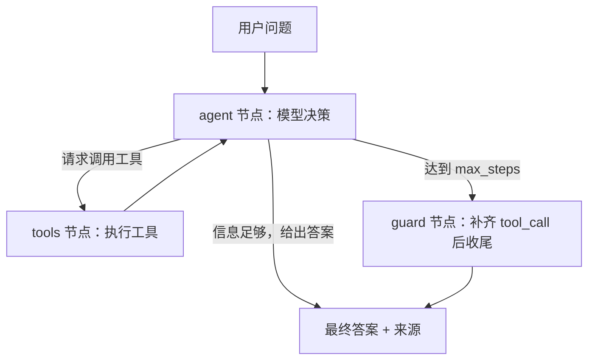
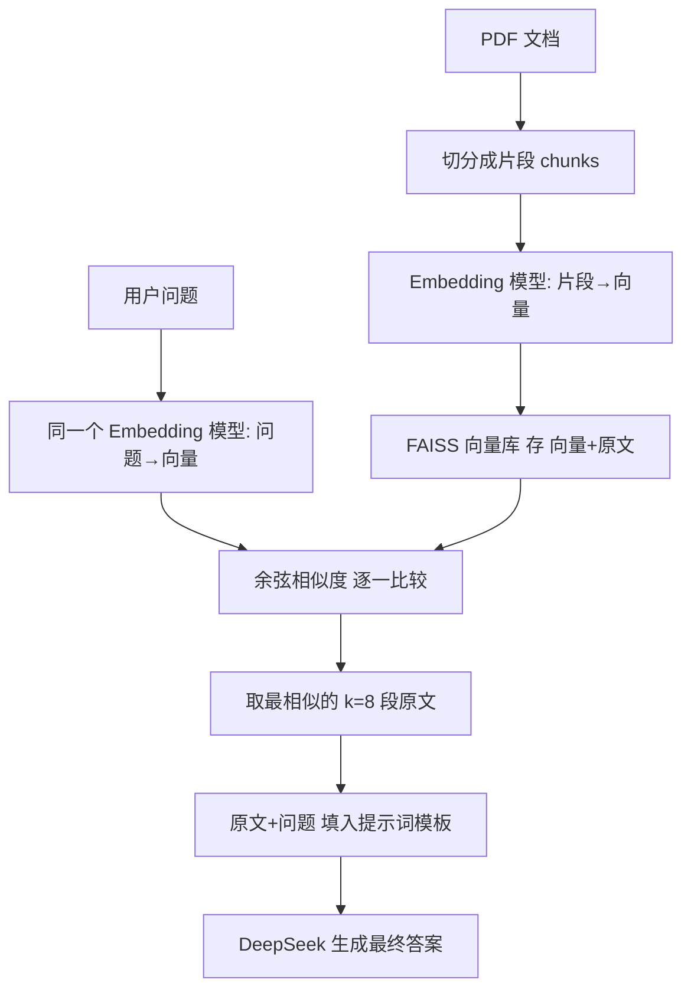

# document-research-agent — 文档研究 Agent

基于 **LangGraph + FAISS + DeepSeek** 的本地文档研究 Agent：把 PDF 放进 `data/`，它就能在多轮推理中自主决定「要不要检索、检索几次、要不要算数、要不要产出报告」，最终给出带来源引用的结论。

与普通 RAG 问答的区别：固定管线（`rag/chain.py`）把「先检索再回答」写死在代码路径里；Agent 层（`agent/`）把这条路径交给模型决策，因此支持多跳检索、跨文档对比、数值计算与报告产出。两套实现都保留，可用 `--baseline` 直接对比效果与成本。

底层检索沿用**增量索引**：新增或修改 PDF 时，只对变化的文件做切块与向量化，无需每次全量重建，省时省 API 开销。

## Agent 架构



四个工具：

| 工具 | 类型 | 作用 |
|---|---|---|
| `search_knowledge_base` | 只读 | 语义检索，返回带文件名/页码的片段（粗筛） |
| `read_document` | 只读 | 读取指定 PDF 指定页原文（精读，核对上下文与数字口径） |
| `calculate` | 纯函数 | AST 白名单四则运算，不使用 `eval` |
| `write_report` | 有副作用 | 把结论写成 `reports/*.md` |

工程细节：

- **步数守卫**：超过 `AGENT_MAX_STEPS`（默认 8）停止继续推理，并在收尾前为悬空的 `tool_call` 补齐 `ToolMessage`——否则历史里留下非法消息，下一次请求会被 OpenAI 兼容接口直接拒绝。
- **多轮记忆**：`MemorySaver` 按 `thread_id` 隔离会话；换成 SQLite/Redis checkpointer 即可持久化，图结构不用改。
- **来源收集**：工具用闭包持有 `collected` 列表，检索命中即记录，最后由 CLI 去重打印。
- **检索与精读分离**：向量检索负责定位线索，`read_document` 负责核对原文，缓解切块丢上下文的问题。

> 当前状态：Agent 循环、工具链、增量索引、30 条确定性评测、SSE 流式服务均已跑通。可选方向：混合检索（BM25）解决表格页召回、Rerank 精排。

## 环境准备

1. 创建并激活虚拟环境，安装依赖：

   ```powershell
   python -m venv .venv
   .venv\Scripts\activate
   pip install -r requirements.txt
   ```

2. 复制 `.env.example` 为 `.env`，填入密钥：

   | 变量 | 必填 | 说明 |
   |---|---|---|
   | `OPENAI_API_KEY` | ✅ | Embedding 向量模型的 API Key（走 OpenAI 兼容接口） |
   | `OPENAI_BASE_URL` | ⬜ | 第三方兼容端点（如阿里云百炼），不填则连 OpenAI 官方 |
   | `EMBEDDING_MODEL` | ⬜ | 向量模型名，默认 `text-embedding-3-small` |
   | `DEEPSEEK_API_KEY` | ✅ | DeepSeek 对话模型 API Key |
   | `DEEPSEEK_MODEL` | ⬜ | 对话模型名，默认 `deepseek-chat` |

## 核心原理：RAG 工作流程

Embedding 模型像"翻译官"，把文档片段和问题都翻译成同一个高维空间的坐标点，**意思相近的文本坐标就挨得近**。检索匹配的不是关键词，而是语义坐标的距离（余弦相似度）。

分工：**Embedding 负责"找到相关内容"，DeepSeek 负责"把内容组织成回答"**。



提问时的详细步骤：

1. **问题向量化**：用与建库时**相同的** Embedding 模型把用户问题转成向量（坐标系必须一致，否则相似度无意义）。
2. **相似度检索**：FAISS 计算问题向量与库中所有文档向量的余弦相似度，排序后取最相近的 `k` 段（默认 8）。
3. **取回原文**：FAISS 内部保存了向量↔原文的映射（`faiss_index/index.pkl`），按编号取回原始文本。
4. **组装提示词**：把原文以 `[资料1] [资料2]...` 编号格式填入提示词的 `{context}`，问题填入 `{question}`。
5. **生成回答**：DeepSeek 拿到的是自然语言原文（不是向量），像"开卷考试"一样基于参考资料作答；资料不足时按提示词要求回答"文档中未找到相关信息"。

## 增量索引机制

早期版本每导入一个 PDF 都会把 `data/` 下**全部文档**重新切块、重新向量化，文件越多越慢、API 花费越高。现在改为**增量更新**，核心由三部分协作：

1. **内容哈希身份证**：对每个 PDF 的二进制做 `sha256`，内容不变哈希就不变（与文件名、修改时间无关）。相同内容的重复文件会被自动去重，不会重复付费。
2. **登记簿 manifest**：`faiss_index/manifest.json` 记录 `{文件哈希: {文件名, 向量ID列表}}`，与索引同目录、同生共死。每次运行扫描 `data/` 并与登记簿对比，得出"新增/变更"和"已删除"两类差异。
3. **稳定 ID 精准增删**：每个文本块的向量 ID 采用 `文件哈希_块序号`，而非 LangChain 默认的随机 UUID。这样：
   - 新文件 → 只切块并向量化该文件，用 `add_documents` 追加进已有索引；
   - 删除/修改文件 → 依据登记簿里的 ID 调 `db.delete()` 精准移除旧向量，其余文件向量原封不动；
   - 无任何变化 → 直接加载索引，一次 Embedding 调用都不发起。
4. **参数指纹防漏重建**：`faiss_index/index_meta.json` 记录切块参数指纹（`chunk_size` / `overlap` / 过滤阈值 / Embedding 模型）。只按文件哈希判断会漏掉“PDF 没变但切块参数改了”的情况——程序认为索引最新，实际一直在用旧索引，表现就是“参数改了、指标纹丝不动”。指纹不匹配时自动转全量重建。

> 需要推倒重来时（如索引混乱、想压缩标记删除占用的空间），用 `--rebuild` 强制全量重建即可。首次从旧版全量索引升级时，也建议先跑一次 `--rebuild` 建立稳定的 ID 基线。

| 场景 | 处理方式 |
|---|---|
| 新增 1 个 PDF | 只向量化该新文件的块 |
| 删除 1 个 PDF | 按稳定 ID 精准删除其向量 |
| 修改 1 个 PDF | 删除旧哈希向量 + 索引新内容 |
| 内容完全相同的重复文件 | 按内容哈希自动去重 |
| 无变化启动 | 直接加载索引，不调用 API |
| 切块参数变更 | 按参数指纹识别，自动全量重建 |

## 代码模块

| 文件 | 职责 |
|---|---|
| `agent/graph.py` | LangGraph 编排：ReAct 循环、步数守卫、多轮记忆 |
| `agent/tools.py` | 四个工具的闭包工厂实现（检索/精读/计算/写报告） |
| `agent/state.py` | Agent 共享状态定义 |
| `agent/prompts.py` | Agent 系统提示词：给出决策边界而非固定路径 |
| `config.py` | pydantic-settings 统一配置，密钥延迟校验 |
| `llm.py` | 对话模型构造：Agent 与 baseline 共用的底层依赖，避免 agent 反向 import 对比实现 |
| `sources.py` | 引用结构契约：`make_source` / `docs_to_sources` / `dedupe_sources`，CLI、SSE、评测共用一份 |
| `rag/loader.py` | PyMuPDF 提取 PDF（含页眉页脚清理）并切分成 chunks；`extract_pages` 供精读复用同一套提取逻辑 |
| `rag/vector_store.py` | 构造 Embedding；构建/加载 FAISS 库，支持稳定 ID 的增量增删（`build_vector_db`/`add_to_vector_db`/`delete_from_vector_db`/`save_vector_db`） |
| `rag/manifest.py` | 已入库 PDF 的登记簿：内容哈希 + 索引参数指纹（改了切块参数会自动全量重建） |
| `rag/chain.py` | 固定管线 RAG：检索 → 组装提示词 → DeepSeek 生成（作为 baseline 保留）；`astream_answer` 是它的流式版 |
| `rag/indexer.py` | 索引构建与增量维护：扫描 `data/`、比对登记簿、按参数指纹决定是否全量重建 |
| `main.py` | CLI 入口：Agent / baseline 两种问答模式 |
| `api.py` | FastAPI 服务层：`/api/ask` SSE 流式问答、`/api/health`、演示页托管 |
| `web/index.html` | 单页演示界面：模式切换、流式答案、工具调用卡片、引用列表 |
| `evaluation/questions.py` | 30 条评测集（单跳/多跳/跨页对比/拒答），标注预期要点、来源页与来源文件 |
| `evaluation/run_eval.py` | 评测执行器：同题跑 baseline 与 Agent，确定性判分，生成对照报告 |
| `evaluation/check_questions.py` | 题库标注校验：先确认要点与页码真的对得上原文，再谈模型答得对不对 |
| `evaluation/check_retrieval.py` | 检索层评估：不经模型，只看向量召回能拿到多少目标页与答案要点 |
| `scripts/smoke_test.py` | 连通性冒烟：LLM / Embedding / 检索链路；索引写临时目录，不碰正式库 |
| `scripts/trace_agent.py` | 轨迹追踪：逐步打印 Agent 决策与工具返回；`--guard` 用假模型验证步数守卫 |
| `faiss_index/` | 向量库持久化目录（`index.faiss` 存向量，`index.pkl` 存原文映射，`manifest.json` 存登记簿） |

## 评测结果

`evaluation/` 是一套 30 条的确定性评测（不请 LLM 当裁判），语料是两份真实年报：

- `1225251805.pdf` 苏宁环球 2025 年年报（A 股、简体、185 页）
- `H2_AN202604091821090996_1.pdf` 腾讯控股 2025 年年报（港股、繁体、282 页）

```powershell
python evaluation/check_questions.py      # 先校验题库：要点与页码是否真对得上原文
python evaluation/check_retrieval.py      # 只测检索层，不调模型，几秒出结果
python evaluation/run_eval.py             # 同题跑 baseline 与 Agent，生成对照报告
python evaluation/run_eval.py --rescore   # 改判分规则后离线重评，不重调 API
```

| 指标 | Baseline | Agent | 变化 |
|---|---|---|---|
| 通过率 | 24/30 | 30/30 | +6 条 |
| 要点覆盖率 | 81.9% | 100.0% | +18.1 pp |
| 页码命中率 | 78.3% | 100.0% | +21.7 pp |
| 拒答正确率 | 7/7 | 7/7 | — |
| 平均步数 | 1.00 | 3.33 | +2.33 |
| 平均输入 token | 3151 | 24580 | 7.8 倍 |
| 延迟中位数 | 1.09s | 6.03s | +4.94s |

分类通过率：单跳 7/8 → 8/8；多跳 6/8 → 8/8；跨页对比 4/7 → 7/7；拒答 7/7 → 7/7。
其中**跨文档题**（需同时取两份年报的数据）baseline 2/4 vs Agent 4/4。

解读：baseline 的 6 条失败全部源于单次 top-k 拿不到目标页——要么命中封面或相近页，要么只拿到两份文档中的一份；Agent 则能换关键词重试、跳文档补检、精读原页核对。代价是 7.8 倍输入 token，所以它适合多文档交叉核对的场景，而不是所有问答。

延迟为什么用中位数：LLM 接口偶发超时重试，实测有 1 条请求卡了 811s，把 30 条的平均值从 1s 抬到 28s。延迟是长尾分布，中位数才代表常态。

### 检索层指标

端到端报告里的“页码命中率”取自模型答案的引用，混了生成端噪声。`check_retrieval.py` 单独量检索层（不调模型，几秒跑完）：

| k | 页码命中 | 要点覆盖 |
|---|---|---|
| 4 | 17/23 (73.9%) | 84.4% |
| 8 | 18/23 (78.3%) | 87.5% |
| 10 | 20/23 (87.0%) | 90.6% |

“要点覆盖”是比页码更硬的指标：页码对了但答案不在的块，只有它能暴露出来。k 从 8 加到 10 只多 2 条页码、3 个点覆盖，却多 25% 上下文，不划算，所以默认取 8。

## 已知问题（下一步优化的依据）

上一版这里记了两条，这轮都动手验证了，结论一正一反：

1. **短块污染：已修复**。封面页只有 33 个字符（“苏宁环球股份有限公司 2025 年年度报告”），实体词密度却极高。问“分地区收入哪个地区降幅最大”时它排第 1，把真正的答案页（p18）挤出了 top-8。现在入库前丢弃清理页眉后不足 80 字的页（两份年报共过滤 4 页：封面、债券节、签字页）和不足 80 字的块。封面不再霸占首位，但 p18 自己是表格页，仍只排到第 9——那是下面第 3 条要解决的问题。

2. **切块粒度太粗：假设不成立**。原以为 `chunk_size=800` 稀释了向量，于是降到 350 重测，结果是**负优化**：块数从 660 涨到 1352，同一页被切成 3~4 块后，检索只召回语义最相近的那一块。问营业收入时召回的是 p7 的“其他有关资料”块，而营业收入表在 p7 的另一块里——**页码命中、答案却不在**。检索层要点覆盖从 87.5% 掉到 71.9%，而且 k 从 6 加到 10 都救不回来（答案块压根进不了候选）。最终保留 800。

   顺带搞清楚了一组耦合参数：块越细，同样的 k 覆盖的页越少。`chunk_size` 降到 350 而 k 仍是 4 时，检索层页码命中率从 73.9% 跌到 60.9%；k 提到 8 才回到 91.3%。**切块和 k 必须同调，只改一个就是负优化。**

3. **剩下的真问题：表格页召回不回来**。修完前两条后，检索层仍拿不到的题集中在两张表上：M1（分季度主要财务指标表，p8）与 M2（营业收入构成表，p18）**都进不了 top-10**，而 C7 问同一张 p18 表也只排到第 9。这两页有个共同点——都是表格，提取后的文本是散落的数字加短表头（“分季度”“分地区”“房地产”），语义信号很弱，纯向量检索匹配不上。

   这也是混合检索（BM25 + 向量）该切入的地方：表头词是**精确词**，BM25 能直接命中，而向量检索做不到。本轮评估后决定**先不上**：Agent 已经 30/30，收益只会体现在 baseline（估计 24→26 左右）和检索层指标上，而多两个依赖、多一层融合逻辑，换来的是一个已经不是瓶颈的环节。检索层基线（要点覆盖 87.5%）已经留好，真到 baseline 本身成为矛盾时再上，改完能直接量化收益。

排除一个常见误判：实测 L2 距离与余弦相似度得到的 top-8 完全一致，说明 Embedding 向量已近似归一化，**问题不在距离度量**，而在入库时的切块与过滤。

## 使用方法

把 PDF 放进 `data/` 目录，然后：

```powershell
# 交互式问答（Agent 模式，多轮记忆；自动增量更新索引）
python main.py

# 单次提问，输出答案后退出
python main.py "文档里讲了什么？"

# 走原始固定管线，用于和 Agent 模式对比
python main.py --baseline "文档里讲了什么？"

# 强制全量重建索引（推倒重来 / 首次从旧版升级 / 压缩索引时）
python main.py --rebuild
```

日常无需手动干预：新增或替换 PDF 后直接 `python main.py`，系统会自动识别差异并只向量化变化的文件。

### Web 服务（SSE 流式）

```powershell
uvicorn api:app --reload --port 8000
```

浏览器打开 http://127.0.0.1:8000 ，顶部可切 Agent / 固定管线，同一个问题能当场对照。启动时会走一遍增量索引校验，索引已是最新则直接加载（不调 API）。也可以直接调接口：

| 接口 | 说明 |
|---|---|
| `POST /api/ask` | SSE 流式问答，body：`{question, mode: "agent"\|"baseline", session_id?}` |
| `GET /api/health` | 索引块数、top_k、步数上限、当前模型 |

`/api/ask` 推送的事件：

| 事件 | 时机 | 前端用途 |
|---|---|---|
| `meta` | 请求开始 | 显示模式与会话 id |
| `tool` | Agent 决定调工具 | 渲染步骤卡片（“检索：xxx”“精读 xx 第 7 页”） |
| `observation` | 工具返回 | 卡片下方显示结果摘要 |
| `token` | 模型产出文本 | 流式追加答案 |
| `sources` | 检索命中 / 回答结束 | 引用列表（按文件+页码去重） |
| `done` | 正常结束 | 显示耗时与推理步数 |
| `error` | 异常 | 错误提示 |

两个实现上容易踩的点：

- **并发隔离**：每次请求都重新 `build_agent`。工具闭包里的引用列表必须按请求私有，否则两条并发问题会把引用混在一起。会话记忆则靠共用的 `MemorySaver` + 前端传入的 `session_id` 区分。
- **思考与答案分段**：模型调用工具前往往先输出一段推理，这段同样走 `token` 事件。前端收到 `tool` 事件时，把已累积的文本降级成“思考”挪进步骤区、答案区清空，这样既保留实时性，又不会让推理混进最终结论。
