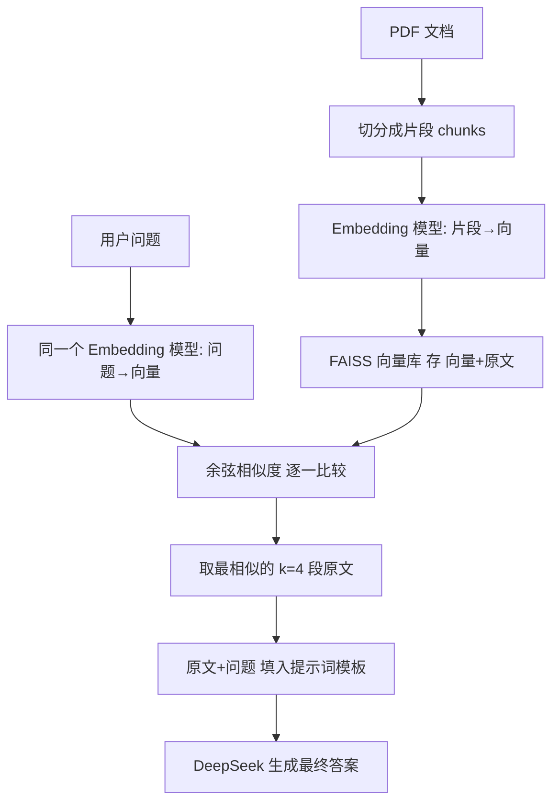

# my_rag_project — 本地 RAG 知识库问答

基于 **FAISS 向量检索 + DeepSeek 生成** 的检索增强生成（RAG）项目：上传 PDF 文档后，可以针对文档内容用自然语言提问，系统先检索相关内容，再让大模型基于检索结果作答，减少幻觉。

支持**增量索引**：新增或修改 PDF 时，只对变化的文件做切块与向量化，无需每次全量重建，省时省 API 开销。

## 环境准备

1. 创建并激活虚拟环境，安装依赖：

   ```powershell
   python -m venv .venv
   .venv\Scripts\activate
   pip install langchain langchain-community langchain-openai langchain-deepseek faiss-cpu pypdf python-dotenv
   ```

2. 复制 `.env.example` 为 `.env`，填入密钥（`.env` 已被 gitignore，不会泄露）：

   | 变量 | 必填 | 说明 |
   |---|---|---|
   | `OPENAI_API_KEY` | ✅ | Embedding 向量模型的 API Key（走 OpenAI 兼容接口） |
   | `OPENAI_BASE_URL` | ⬜ | 第三方兼容端点（如阿里云百炼），不填则连 OpenAI 官方 |
   | `EMBEDDING_MODEL` | ⬜ | 向量模型名，默认 `text-embedding-3-small` |
   | `DEEPSEEK_API_KEY` | ✅ | DeepSeek 对话模型 API Key |
   | `DEEPSEEK_MODEL` | ⬜ | 对话模型名，默认 `deepseek-chat` |

## 核心原理：RAG 工作流程

Embedding 模型像"翻译官"，把文档片段和问题都翻译成同一个高维空间的坐标点，**意思相近的文本坐标就挨得近**。检索匹配的不是关键词，而是语义坐标的距离（余弦相似度）。

分工：**Embedding 负责"找到相关内容"，DeepSeek 负责"把内容组织成回答"**。



提问时的详细步骤：

1. **问题向量化**：用与建库时**相同的** Embedding 模型把用户问题转成向量（坐标系必须一致，否则相似度无意义）。
2. **相似度检索**：FAISS 计算问题向量与库中所有文档向量的余弦相似度，排序后取最相近的 `k` 段（默认 4）。
3. **取回原文**：FAISS 内部保存了向量↔原文的映射（`faiss_index/index.pkl`），按编号取回原始文本。
4. **组装提示词**：把原文以 `[资料1] [资料2]...` 编号格式填入提示词的 `{context}`，问题填入 `{question}`。
5. **生成回答**：DeepSeek 拿到的是自然语言原文（不是向量），像"开卷考试"一样基于参考资料作答；资料不足时按提示词要求回答"文档中未找到相关信息"。

## 增量索引机制

早期版本每导入一个 PDF 都会把 `data/` 下**全部文档**重新切块、重新向量化，文件越多越慢、API 花费越高。现在改为**增量更新**，核心由三部分协作：

1. **内容哈希身份证**：对每个 PDF 的二进制做 `sha256`，内容不变哈希就不变（与文件名、修改时间无关）。相同内容的重复文件会被自动去重，不会重复付费。
2. **登记簿 manifest**：`faiss_index/manifest.json` 记录 `{文件哈希: {文件名, 向量ID列表}}`，与索引同目录、同生共死。每次运行扫描 `data/` 并与登记簿对比，得出"新增/变更"和"已删除"两类差异。
3. **稳定 ID 精准增删**：每个文本块的向量 ID 采用 `文件哈希_块序号`，而非 LangChain 默认的随机 UUID。这样：
   - 新文件 → 只切块并向量化该文件，用 `add_documents` 追加进已有索引；
   - 删除/修改文件 → 依据登记簿里的 ID 调 `db.delete()` 精准移除旧向量，其余文件向量原封不动；
   - 无任何变化 → 直接加载索引，一次 Embedding 调用都不发起。

> 需要推倒重来时（如索引混乱、想压缩标记删除占用的空间），用 `--rebuild` 强制全量重建即可。首次从旧版全量索引升级时，也建议先跑一次 `--rebuild` 建立稳定的 ID 基线。

| 场景 | 处理方式 |
|---|---|
| 新增 1 个 PDF | 只向量化该新文件的块 |
| 删除 1 个 PDF | 按稳定 ID 精准删除其向量 |
| 修改 1 个 PDF | 删除旧哈希向量 + 索引新内容 |
| 内容完全相同的重复文件 | 按内容哈希自动去重 |
| 无变化启动 | 直接加载索引，不调用 API |

## 代码模块

| 文件 | 职责 |
|---|---|
| `rag/loader.py` | 加载 PDF 并切分成文本片段（chunks） |
| `rag/vector_store.py` | 构造 Embedding；构建/加载 FAISS 库，支持稳定 ID 的增量增删（`build_vector_db`/`add_to_vector_db`/`delete_from_vector_db`/`save_vector_db`） |
| `rag/manifest.py` | 已入库 PDF 的登记簿：内容哈希计算与 `manifest.json` 读写 |
| `rag/chain.py` | RAG 问答链：检索 → 组装提示词 → DeepSeek 生成 |
| `main.py` | 入口脚本，`index_documents` 实现增量索引维护 |
| `test_llm.py` | 连通性测试脚本 |
| `faiss_index/` | 向量库持久化目录（`index.faiss` 存向量，`index.pkl` 存原文映射，`manifest.json` 存登记簿） |

## 使用方法

把 PDF 放进 `data/` 目录，然后：

```powershell
# 交互式问答（自动增量更新索引：只处理新增/变化的 PDF，无变化则直接加载）
python main.py

# 单次提问，输出答案后退出
python main.py "文档里讲了什么？"

# 强制全量重建索引（推倒重来 / 首次从旧版升级 / 压缩索引时）
python main.py --rebuild
```

日常无需手动干预：新增或替换 PDF 后直接 `python main.py`，系统会自动识别差异并只向量化变化的文件。
